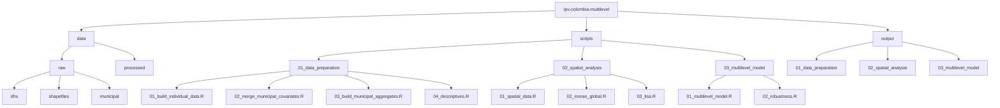

This repository contains the data and code used in a study on the individual and municipal determinants of intimate partner violence (IPV) in Colombia, based on the 2015 National Demographic and Health Survey (ENDS 2015), spatial autocorrelation analysis, and multilevel logistic models.

This repository is organized as follows:

